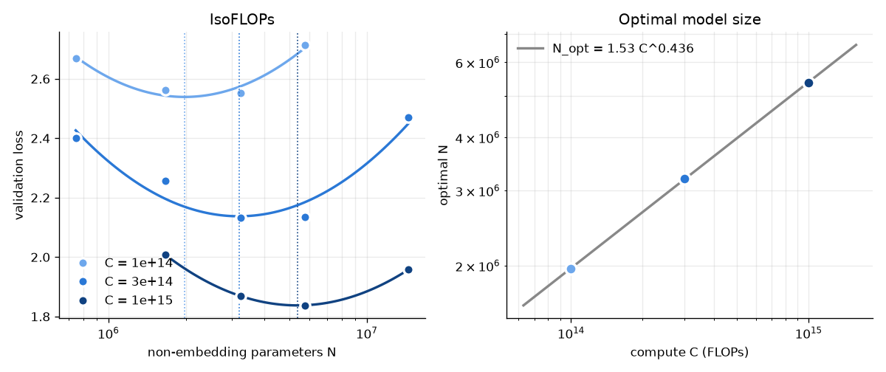

# Mac 上的迷你 scaling law

## 本集目標

在 Mac 上真的訓練 13 個小模型，畫出三個預算的 IsoFLOPs 曲線，擬合最佳參數量的冪律，並誠實看待這麼小的實驗能說明什麼、不能說明什麼。

## 正文

### 預算換算成步數

每個實驗先決定預算 \\( C \\) 與模型，再用 \\( C = 6ND \\) 算出要看幾個 token，換算成訓練步數：

```python,ignore
{{#include ../../../src/llmz/scaling.py:budget}}
```

\\( N \\) 用**扣掉 embedding 表**的參數量：查表不做矩陣乘法，幾乎不花計算量；最後的 lm_head 要做矩陣乘法，所以留著。Kaplan 等人的論文也不算 embedding 的參數。

### 五種大小、三個預算

每個 head 固定 32 維，詞彙表與 context 長度和標準模型一樣（10000、256），batch 32：

| 名稱 | `d_model` | 層數 | head 數 | `d_ff` | \\( N \\)（不含 embedding） |
| --- | --- | --- | --- | --- | --- |
| d64 | 64 | 2 | 2 | 192 | 746,816 |
| d128 | 128 | 2 | 4 | 320 | 1,657,472 |
| d192 | 192 | 3 | 6 | 512 | 3,248,448 |
| d256 | 256 | 4 | 8 | 704 | 5,773,568 |
| d384 | 384 | 6 | 12 | 1024 | 14,461,824 |

預算選 \\( 10^{14} \\)、\\( 3 \times 10^{14} \\)、\\( 10^{15} \\) FLOPs，每個預算挑四到五種大小，預算越大挑得越大。所有實驗都用同一組超參數：學習率從 3e-3 以 cosine 降到 3e-4，warmup 是總步數的 5%（至少 20 步），只在最後一步用 100 批驗證資料算 loss。`tools/scaling_sweep.py` 把這些設定交給第 5 章的 `train`，結果一行一行寫進 `runs/scaling/results.jsonl`：

```bash
uv run tools/scaling_sweep.py
```

在 M4 Max 上，13 個實驗的訓練時間加起來約 69 分鐘；最久的是 \\( 10^{15} \\) 的 d128，看了 1 億個 token，花了 16 分鐘。中斷後重跑會跳過已經做完的組合。

### 結果

驗證 loss：

| 預算 | d64 | d128 | d192 | d256 | d384 |
| --- | --- | --- | --- | --- | --- |
| \\( 10^{14} \\) | 2.6687 | 2.5633 | **2.5516** | 2.7142 | |
| \\( 3 \times 10^{14} \\) | 2.4003 | 2.2566 | **2.1331** | 2.1350 | 2.4697 |
| \\( 10^{15} \\) | | 2.0080 | 1.8694 | **1.8375** | 1.9577 |



圖是用 `uv run tools/plot_scaling.py runs/scaling/results.jsonl` 畫的。和第 2 集一樣，每個預算都是一條 U 形曲線：太小的模型容量不夠，太大的模型看的資料太少。預算越大，整條曲線越低，最低點也往右移。

### 擬合

把上面的表格直接寫進程式，用第 3、4 集的兩個函式：

```python
import numpy as np

from llmz.scaling import fit_isoflop_minimum, fit_power_law

n = {"d64": 746_816, "d128": 1_657_472, "d192": 3_248_448, "d256": 5_773_568, "d384": 14_461_824}
results = {  # 預算: {大小: 驗證 loss}
    1e14: {"d64": 2.6687, "d128": 2.5633, "d192": 2.5516, "d256": 2.7142},
    3e14: {"d64": 2.4003, "d128": 2.2566, "d192": 2.1331, "d256": 2.1350, "d384": 2.4697},
    1e15: {"d128": 2.0080, "d192": 1.8694, "d256": 1.8375, "d384": 1.9577},
}
best = []
for c, losses in results.items():
    n_opt = fit_isoflop_minimum([n[k] for k in losses], list(losses.values()))
    d_opt = c / (6 * n_opt)
    best.append(n_opt)
    print(f"C = {c:.0e}：N_opt = {n_opt:.2e}，D_opt = {d_opt:.2e}，每個參數 {d_opt / n_opt:.1f} 個 token")

k, a = fit_power_law(np.array(list(results)), np.array(best))
print(f"N_opt = {k:.3g} × C^{a:.3f}")
c = 1e21
n_big = k * c**a
print(f"外推到 C = {c:.0e}：N = {n_big:.2e}，每個參數 {c / (6 * n_big) / n_big:.0f} 個 token")
```

執行結果：

```text
C = 1e+14：N_opt = 1.97e+06，D_opt = 8.46e+06，每個參數 4.3 個 token
C = 3e+14：N_opt = 3.20e+06，D_opt = 1.56e+07，每個參數 4.9 個 token
C = 1e+15：N_opt = 5.38e+06，D_opt = 3.10e+07，每個參數 5.8 個 token
N_opt = 1.53 × C^0.436
外推到 C = 1e+21：N = 2.24e+09，每個參數 33 個 token
```

指數 0.436，和第 4 集從 Chinchilla 公式擬合出來的 0.441 很接近。指數小於 0.5，代表預算越大、每個參數該配的 token 越多：外推到 \\( 10^{21} \\) 時是 33 個。但這一行只是示範怎麼用：從 \\( 10^{15} \\) 往外推六個數量級，第 4 集算過，指數一點點誤差就會被放大，何況這裡只有三個點。

### 最低點要落在掃描範圍裡

\\( 3 \times 10^{14} \\) 這一列一開始只掃到 d256。只用前四個點擬合會怎樣？

```python
import numpy as np

from llmz.scaling import fit_isoflop_minimum

n = np.array([746_816, 1_657_472, 3_248_448, 5_773_568])
loss = np.array([2.4003, 2.2566, 2.1331, 2.1350])
print(f"{fit_isoflop_minimum(n, loss):.2e}")
```

執行結果：

```text
6.59e+06
```

頂點落在 d256（\\( 5.77 \times 10^6 \\)）的右邊，超出掃描範圍。第 3 集說過這時拋物線的外推不可靠，所以 `tools/scaling_sweep.py` 往大的方向補了 d384。補上之後 d384 的 loss 明顯變差，曲線兩邊都翹起來，頂點回到 \\( 3.2 \times 10^6 \\)，在範圍裡面。

### 和 Chinchilla 不一樣的地方

每個參數只配 4 到 6 個 token，遠少於 Chinchilla 的 20 個。這不代表 Chinchilla 錯了，而是我們的實驗離論文的設定很遠：

- **規模太小**：最大的預算 \\( 10^{15} \\) FLOPs，比 Chinchilla 實驗的最小預算 \\( 6 \times 10^{18} \\) 還小了六千倍。這麼小的模型裡，lm_head（\\( 10000 \times d \\)）佔了參數量的一大塊，例如 d64 的 74 萬個參數裡有 64 萬個是 lm_head，「參數量」的意義和大模型不太一樣。
- **資料**：TinyStories 用字簡單、句型重複，小模型看少量資料就學到大部分規律，最佳點自然偏向大模型、少資料。
- **重複資料**：訓練集只有 4072 萬個 token，\\( 10^{15} \\) 的 d128 看了 1 億個，等於重複看了 2.5 輪；公式假設每個 token 都是新的。
- **超參數**：所有大小都用同一個學習率，對某些大小不公平。
- **雜訊**：\\( 3 \times 10^{14} \\) 的 d192 與 d256 只差 0.002，換一個隨機種子可能就反過來，頂點也跟著移動。只有三個預算，冪律的指數也不太穩。

所以這一集的重點是**流程**，不是數字：選預算、掃大小、擬合拋物線、擬合冪律、確認頂點在範圍裡。換成真正的資料與預算，流程完全一樣。下一集整理這些限制，並介紹解決學習率問題的方法。

## 重點整理

- `tools/scaling_sweep.py` 在三個預算下訓練了 13 個模型，M4 Max 約 69 分鐘；`tools/plot_scaling.py` 畫出 IsoFLOPs 曲線與冪律。
- 三個預算的最佳參數量是 \\( 2.0 \times 10^6 \\)、\\( 3.2 \times 10^6 \\)、\\( 5.4 \times 10^6 \\)，擬合出 \\( N_{\text{opt}} \propto C^{0.436} \\)。
- 頂點落在掃描範圍外時，要往那個方向補點再擬合。
- 每個參數只配 4 到 6 個 token，和 Chinchilla 不同；規模、資料、重複、超參數、雜訊都會影響，學到的是流程而不是數字。
