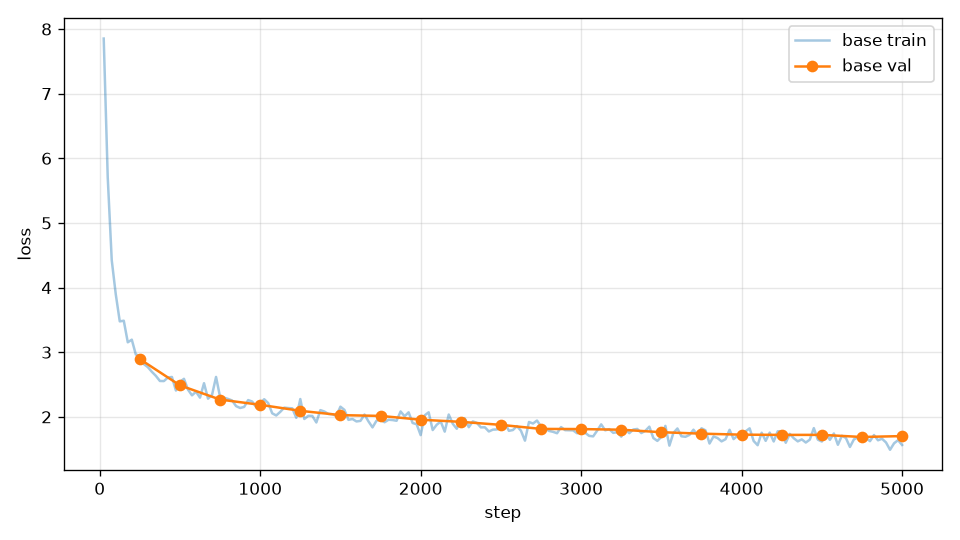

# 第一次完整訓練 TinyStories（40M tokens）

## 本集目標

用標準設定在標準語料上跑完 5000 步，得到本書第一個真正的語言模型，知道正常的 loss 曲線長什麼樣、要多久。

## 正文

### 指令

先確認 `data/train.bin`、`data/valid.bin`、`data/tokenizer.json` 都在（第 3 章第 14 集），然後：

```bash
uv run tools/train.py --out_dir runs/base --compile
```

`tools/train.py` 把 `TrainConfig` 與 `ModelConfig` 的每個欄位都變成命令列參數，不給就用預設值，所以這一行就是標準設定：2270 萬參數、batch 32 × 256、5000 步、AdamW、warmup 200 步再 cosine 到 \\( 10^{-4} \\)、梯度裁剪 1.0。`--compile` 在 MPS 上快 1.6 倍（上一集）；沒有 GPU 的機器拿掉它也能跑，只是三個多小時。

中斷了（Ctrl-C、當機）就再執行同一行，會從 `runs/base/latest.pt` 接續。

### 實測

M4 Max（36 GB），`--compile`：

| 步數 | 訓練 loss | 驗證 loss | 經過時間 |
| --- | --- | --- | --- |
| 250（warmup 結束） | 2.94 | 2.89 | 1.0 分 |
| 500 | 2.54 | 2.49 | 2.1 分 |
| 1000 | 2.21 | 2.19 | 4.3 分 |
| 2000 | 1.72 | 1.96 | 8.7 分 |
| 3000 | 1.87 | 1.81 | 13.1 分 |
| 4000 | 1.66 | 1.72 | 17.3 分 |
| 5000 | 1.57 | **1.70** | 21.8 分 |

最後驗證 loss 1.70，perplexity \\( e^{1.70} = 5.5 \\)：模型平均在 5.5 個 token 裡猜下一個，從一開始的一萬個降下來。整個過程 22 分鐘（含編譯）；梯度長度一路在 0.4 到 0.5 之間，最大的一步 2.4，被裁剪擋住，沒有任何一步 loss 跳起來。



淡線是每 25 步記一次的訓練 loss，實線是每 250 步在驗證集上抽 20 批算的驗證 loss。

### 看懂曲線

- **前 250 步**：從 9.2 掉到 2.9，這段學到的是「哪些 token 常出現」「空白後面接什麼」這種統計，最便宜也最有效。
- **250 到 2000 步**：從 2.9 到 2.0，學會常見的詞組與簡單的句法，此時生成的句子已經像英文了。
- **2000 步之後**：每 1000 步只降 0.1 左右，學習率也在往下走。這段在學比較長距離的東西：主角的名字要一致、對話要有引號。
- 訓練 loss（淡線）比驗證 loss 吵得多，因為每一批只有 8192 個 token；單看某一步的訓練 loss 沒意義，看趨勢。
- 訓練 loss 與驗證 loss 最後相差 0.13：訓練集只看了一輪，模型還沒機會背下來，所以兩者接近。看很多輪的話訓練 loss 會一直降、驗證 loss 停住甚至回升，那就是過擬合。

第 6 章第 4 集會拿這個模型生成故事。

### 記憶體不夠時

batch 32 × 256 在 MPS 上用 5.5 GB。8 GB 的機器把 batch 減半、步數加倍：`--batch_size 16 --max_steps 10000`，看的 token 總數一樣，結果接近（第 6 章第 10 集會比較 batch 大小）。

## 重點整理

- `uv run tools/train.py --out_dir runs/base --compile`：標準設定一行跑完，中斷重跑自動接續。
- M4 Max 實測 22 分鐘，驗證 loss 從 9.2 降到 1.70（perplexity 5.5）；前 250 步掉最快，2000 步後每千步降 0.1。
- 訓練 loss 比驗證 loss 吵，看趨勢用驗證 loss；兩者接近代表沒有過擬合。
