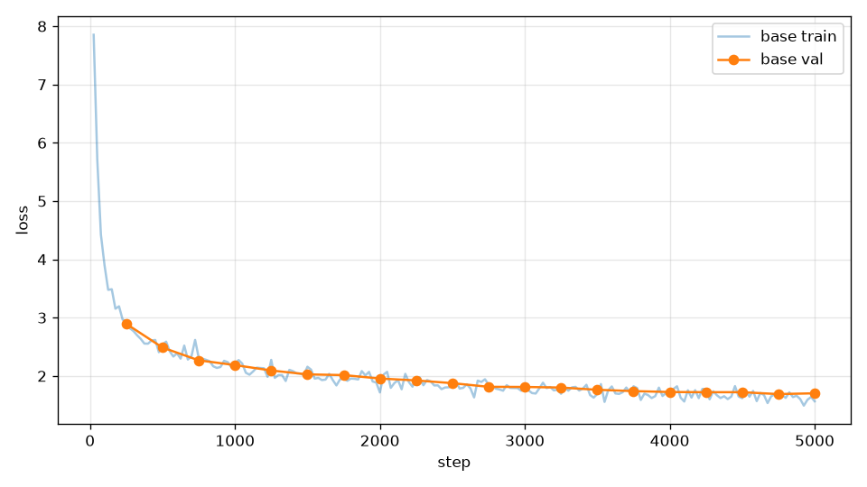

# 畫 loss 曲線

## 本集目標

讀 `log.jsonl` 用 matplotlib 畫出訓練與驗證 loss，第 6 章的所有實驗都靠這張圖比較。

## 正文

### 讀 JSONL

一行一個 JSON 物件，逐行 `json.loads` 就是一個字典的串列：

```python
import json

lines = [
    '{"step": 25, "loss": 7.8, "lr": 0.000125, "grad_norm": 1.2, "time": 7.1}',
    '{"step": 250, "loss": 3.4, "lr": 0.000998, "grad_norm": 0.5, "time": 69.3, "val_loss": 3.3}',
    '{"step": 500, "loss": 2.6, "lr": 0.000991, "grad_norm": 0.4, "time": 135.0, "val_loss": 2.5}',
]
with open("log.jsonl", "w") as f:
    f.write("\n".join(lines) + "\n")

with open("log.jsonl") as f:
    records = [json.loads(line) for line in f]
print(len(records), records[1]["val_loss"])
print([r["step"] for r in records if "val_loss" in r])
```

執行結果：

```text
3 3.3
[250, 500]
```

這裡先手寫三行當範例；真的檔案是 `runs/base/log.jsonl`，200 行。不是每一行都有 `val_loss`（每 250 步才評估一次），畫圖時要用 `"val_loss" in r` 挑出來。

### 畫圖

`tools/plot_loss.py` 做這件事，可以一次畫好幾個 run：

```python,ignore
{{#include ../../../tools/plot_loss.py}}
```

- `plt.subplots` 給一張圖與一個座標軸 `ax`；`ax.plot(x, y)` 畫一條線，`alpha=0.4` 讓訓練 loss 淡一點（它很吵），驗證 loss 畫實線加圓點。
- `fig.savefig` 存成 PNG；在終端機執行不需要開視窗。

```bash
uv run tools/plot_loss.py runs/base -o loss.png
```

第 10 集那張圖就是這樣畫的：



### 讀圖的習慣

- 前 200 步（warmup）掉得最快，從 9.2 到 5 以下：模型先學會「哪些 token 常出現」。
- 之後一路緩降，曲線變平不代表沒在學，只是每一步進步變小；最後 1000 步學習率已經很低，曲線幾乎水平。
- 訓練 loss 的鋸齒是 batch 之間的差異，不是問題；驗證 loss 平滑得多。
- 如果某一步 loss 突然跳上去又不回來，看同一筆的 `grad_norm`：多半那一步前後梯度飆高，第 5 集的裁剪沒擋住，學習率可能太大（第 6 章第 9 集會看到）。

## 重點整理

- JSONL：逐行 `json.loads`；驗證 loss 只在部分行有，用 `"val_loss" in r` 挑。
- `uv run tools/plot_loss.py runs/<名稱> [更多 run] -o 檔名.png`，訓練 loss 淡線、驗證 loss 實線。
- 看趨勢用驗證 loss；warmup 階段掉最快，尾段因學習率低而變平。

## 自我挑戰

這一章放進 `src/llmz/` 的東西：

- `src/llmz/optim.py`：`SGD`、`AdamW`、`lr_cosine_schedule`、`clip_grad_norm_`
- `src/llmz/data.py`：`get_batch`
- `src/llmz/train.py`：`save_checkpoint`、`load_checkpoint`、`evaluate`、`train`

建議順序：`lr_cosine_schedule` 與 `clip_grad_norm_` 先（純數學）；再 `SGD.step`、`AdamW.step`（`tests/test_optim.py` 會和 `torch.optim` 的版本比到小數點後六位）；然後 `get_batch`；最後把 `train` 的主迴圈清掉自己寫回來，`tests/test_train.py` 的 smoke 訓練要能在 60 步內把 loss 壓到 1 以下。

```bash
uv run pytest tests/test_optim.py tests/test_data.py tests/test_train.py
```

全部通過後，用你自己寫的版本重跑一次完整訓練，驗證 loss 應該和第 10 集的差不到 0.05。
