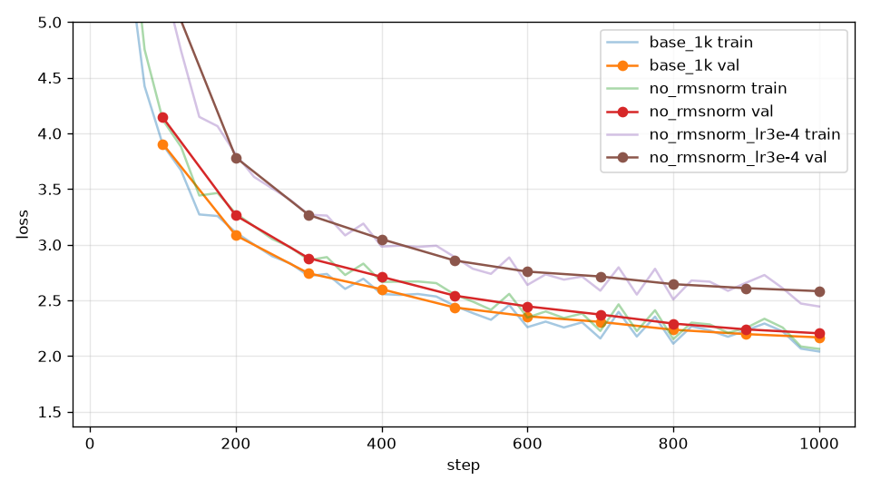

# 消融：拿掉 RMSNorm

## 本集目標

學會消融實驗（ablation）的做法：改一個零件、其他全部不動、比 loss 曲線。第一個實驗把 RMSNorm 整個拿掉，看第 4 章第 4 集說的「沒有它訓練不穩」是真是假。

## 正文

### 實驗設定

完整訓練要半小時，六個實驗跑不完。本章所有實驗都用縮短的設定：1000 步、其餘和標準設定相同（820 萬個 token，cosine 排程在第 1000 步降到最低）。先跑一個縮短版的基準，之後每個實驗都和它比：

```bash
uv run tools/train.py --out_dir runs/base_1k --compile --max_steps 1000 --eval_every 100
```

`--eval_every 100` 讓驗證 loss 密一點，曲線才看得清楚。M4 Max 上每個實驗約五分鐘。

### 拿掉 RMSNorm

`ModelConfig` 的 `norm="none"` 會把 block 裡與最後的 RMSNorm 全換成 `Identity`（第 4 章第 13 集）：

```bash
uv run tools/train.py --out_dir runs/no_rmsnorm --compile --max_steps 1000 --eval_every 100 --norm none
uv run tools/train.py --out_dir runs/no_rmsnorm_lr3e-4 --compile --max_steps 1000 --eval_every 100 --norm none --lr_max 3e-4 --lr_min 3e-5
```

第二行把學習率降到三分之一再試一次，看不穩定能不能用小步伐救回來。

### 結果

1000 步，M4 Max 每個約 4.6 分鐘：

| run | 第 200 步驗證 loss | 第 1000 步驗證 loss | 平均梯度長度 | 最大梯度長度 |
| --- | --- | --- | --- | --- |
| 基準（有 RMSNorm） | 3.08 | **2.17** | 0.52 | 2.4 |
| 拿掉 RMSNorm | 3.26 | 2.20 | 2.25 | 38.8 |
| 拿掉 RMSNorm、學習率 \\( 3\times10^{-4} \\) | 3.78 | 2.58 | 4.73 | 73.3 |



先看最後的 loss：拿掉 RMSNorm 只差 0.04。4 層的小模型、只練 1000 步，沒有它也訓練得起來，這和「沒有 norm 就不穩」的印象不太一樣。

但梯度長度說了另一個故事。基準的梯度長度平均 0.52；拿掉 RMSNorm 之後平均 2.25、最大 38.8，幾乎每一步都超過第 5 章第 5 集設的上限 1.0，**每一步都在被裁剪**。換句話說，模型之所以沒炸，是梯度裁剪在硬撐。把裁剪拿掉，這個實驗多半會在前幾百步就出現 loss 暴衝。

第二個 run 把學習率降到三分之一，想用小步伐換穩定，結果更差（2.58）：梯度長度反而更大，每步又被裁成 1，實際走的距離變得更短，前 1000 步根本學不夠。

結論：在這個尺寸上，RMSNorm 的主要功勞是讓梯度維持在正常大小，讓學習率與裁剪的設定都「剛好」；拿掉它，最後的 loss 看起來差不多，但整個訓練靠裁剪撐著。層數一多（幾十層），沒有 norm 的模型連裁剪都救不回來。

### 怎麼讀消融

- 只改一個東西。同時改兩個，就不知道是誰的功勞。
- 種子、資料順序、步數全部一樣（`tools/train.py` 的 `seed` 預設 0，`get_batch` 的起點由它決定，所以每個實驗看到的 batch 序列相同）。
- 看驗證 loss 的**最後幾個點**，也看曲線中間有沒有抖動或跳起來。
- 差 0.03 以內當成 batch 抽樣的雜訊；差 0.05 以上才值得相信。

## 重點整理

- 消融：改一個零件、其他不動、比曲線；本章用 1000 步的縮短設定，基準是 `runs/base_1k`。
- 拿掉 RMSNorm：1000 步驗證 loss 只差 0.04，但梯度長度平均變 4 倍、每步都被裁剪；降低學習率反而更差。
- 看消融不能只看最後的 loss，`grad_norm` 這種過程指標同樣重要。
- 差 0.03 以內當成雜訊，0.05 以上才值得相信。
