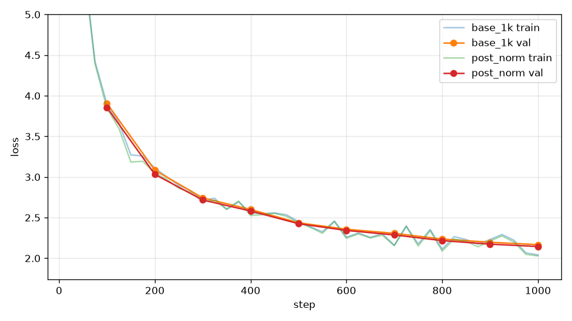

# 消融：post-norm

## 本集目標

把 RMSNorm 從子層之前移到殘差相加之後（post-norm），看第 4 章第 13 集說的「pre-norm 比較穩」。

## 正文

### 差在哪裡

```text
pre-norm（本書預設）            post-norm
x = x + attn(norm(x))          x = norm(x + attn(x))
x = x + ffn(norm(x))           x = norm(x + ffn(x))
```

post-norm 是最早的 Transformer 用法。差別在殘差那條路：pre-norm 從第一層到最後一層是純加法，梯度直通；post-norm 每一層都把整個 `x` 重新正規化，梯度每過一層就被 norm 的導數改一次，層數多了訊號會變形。

```bash
uv run tools/train.py --out_dir runs/post_norm --compile --max_steps 1000 --eval_every 100 --norm_position post
```

### 結果

TBD_TABLE_POST



TBD_TEXT_POST

## 重點整理

- post-norm：`norm(x + sublayer(x))`；pre-norm：`x + sublayer(norm(x))`。
- TBD_SUMMARY_POST
- 現代 LLM 幾乎都用 pre-norm，原因就是這條曲線。
