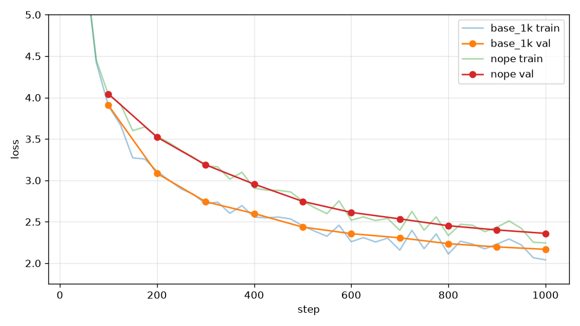

# 消融：NoPE

## 本集目標

把 RoPE 拿掉（NoPE，no positional encoding），看模型沒有位置資訊會怎樣，順便驗證第 4 章第 6 集的說法。

## 正文

### 沒有位置資訊真的不行嗎

第 4 章第 6 集說 attention 分不出順序。但 causal mask 其實偷偷給了一點位置資訊：位置 0 只能看一個 token、位置 5 能看六個，attention 的輸出會隨「前面有幾個 token」而變，模型可以從這裡推出大概的位置。所以 NoPE 不會完全學不動，問題是學得多慢、多差。

```bash
uv run tools/train.py --out_dir runs/nope --compile --max_steps 1000 --eval_every 100 --no-rope
```

`--no-rope` 是 `tools/train.py` 對布林欄位自動產生的寫法（`--rope` 開、`--no-rope` 關）。

### 結果

| run | 第 200 步驗證 loss | 第 500 步 | 第 1000 步 |
| --- | --- | --- | --- |
| RoPE（基準） | 3.08 | 2.44 | **2.17** |
| NoPE | 3.52 | 2.75 | 2.36 |



NoPE 學得起來，但每個時間點都落後一截，1000 步時差 0.19，是本章四個零件消融裡差距最大的。前 200 步的差距（0.44）比最後還大：一開始模型要學的就是「前一個字是什麼」這種短距離的規律，沒有位置資訊時最吃虧。

照第 5 集的標準，0.19 遠超過雜訊，可以放心說：在這個設定下 RoPE 很值得。

## 重點整理

- NoPE 靠 causal mask 間接得到粗略的位置資訊，所以不會完全失敗。
- NoPE 1000 步驗證 loss 2.36，比 RoPE 差 0.19，而且前期差更多。
- RoPE 不增加參數，只是幾個 cos、sin 的乘法，是最划算的零件之一。
