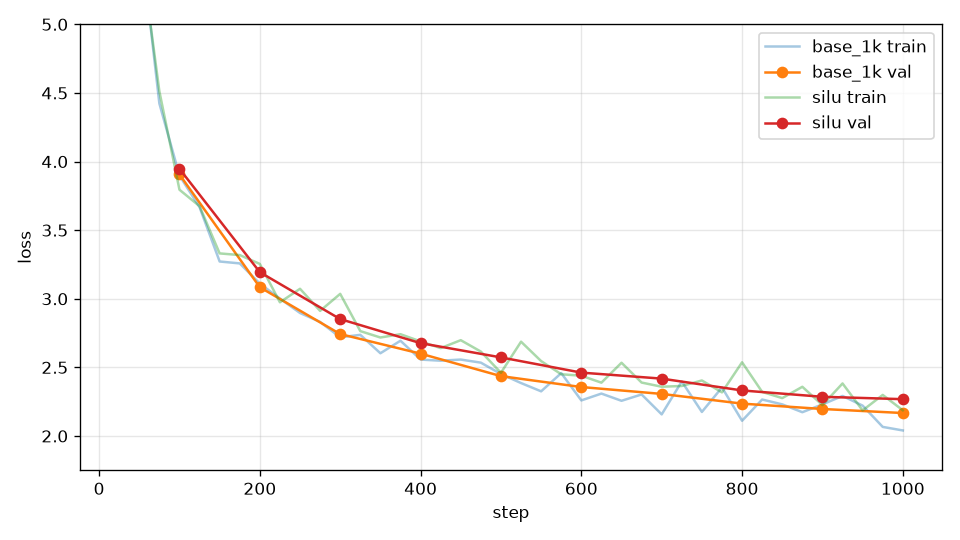

# 消融：SiLU 取代 SwiGLU

## 本集目標

把 SwiGLU 的 gate 拿掉，換成最簡單的 `w2(silu(w1(x)))`，在參數量相同的條件下比較。

## 正文

### 公平比較

SwiGLU 三個矩陣 \\( 3 \times d \times d_{\text{ff}} \\)，標準設定 \\( d_{\text{ff}} = 1344 \\)，每層 206 萬個參數。沒有 gate 的 FFN 只有兩個矩陣，如果 `d_ff` 不變，參數少三分之一，輸了也不知道是少了 gate 還是少了參數。所以把 `d_ff` 加到 2048：\\( 2 \times 512 \times 2048 = 210 \\) 萬，和 SwiGLU 幾乎一樣（第 4 章第 5 集說的 \\( 4d \\) 慣例就是這個）。

```bash
uv run tools/train.py --out_dir runs/silu --compile --max_steps 1000 --eval_every 100 --ffn silu --d_ff 2048
```

### 結果

TBD_TABLE_SILU



TBD_TEXT_SILU

## 重點整理

- 比較不同結構時先把參數量對齊：SiLU FFN 用 \\( d_{\text{ff}} = 4d \\)，SwiGLU 用 \\( 8d/3 \\)。
- TBD_SUMMARY_SILU
