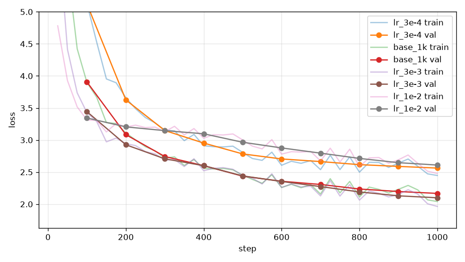

# 學習率掃描

## 本集目標

同一個模型用四個學習率各跑一次，找出太小、剛好、太大的界線，知道學習率為什麼是最重要的超參數。

## 正文

### 四個值

`lr_min` 跟著 `lr_max` 一起縮放（維持十分之一）：

```bash
uv run tools/train.py --out_dir runs/lr_3e-4 --compile --max_steps 1000 --eval_every 100 --lr_max 3e-4 --lr_min 3e-5
uv run tools/train.py --out_dir runs/lr_3e-3 --compile --max_steps 1000 --eval_every 100 --lr_max 3e-3 --lr_min 3e-4
uv run tools/train.py --out_dir runs/lr_1e-2 --compile --max_steps 1000 --eval_every 100 --lr_max 1e-2 --lr_min 1e-3
```

基準 `runs/base_1k` 是 \\( 10^{-3} \\)。四個值每個差三倍左右，這是掃學習率的慣例：差距太小看不出差別，太大會漏掉最好的區間。

### 結果

| `lr_max` | 第 200 步驗證 loss | 第 500 步 | 第 1000 步 |
| --- | --- | --- | --- |
| \\( 3\times10^{-4} \\) | 3.63 | 2.78 | 2.56 |
| \\( 10^{-3} \\)（基準） | 3.08 | 2.44 | 2.17 |
| \\( 3\times10^{-3} \\) | 2.93 | 2.44 | **2.10** |
| \\( 10^{-2} \\) | 3.21 | 2.97 | 2.61 |



四條曲線分成三種：

- **太小**（\\( 3\times10^{-4} \\)）：一路穩穩往下，但每一步走太少，1000 步還沒走到；給它更多步數會追上來，只是浪費時間。
- **剛好**（\\( 10^{-3} \\) 與 \\( 3\times10^{-3} \\)）：兩條幾乎重疊，\\( 3\times10^{-3} \\) 最後低 0.07。所以本書標準設定的 \\( 10^{-3} \\) 其實保守了一點，在 1000 步的短訓練上 \\( 3\times10^{-3} \\) 更好。
- **太大**（\\( 10^{-2} \\)）：前 100 步降得最快，接著卡在 3.1 附近停了好幾百步，最後只到 2.61。它沒有變成 `nan`，因為梯度裁剪每一步都把步伐限住；但大學習率讓參數在一個不好的區域來回跳，要等 cosine 把學習率降下來才慢慢往下走。

「太大」不一定是 loss 爆掉，常常是這種卡住的平台。看到前期快、中期停，第一個懷疑學習率。

### 怎麼選

一般的經驗：先掃三倍一格，最好的值通常就在「開始變差的那一格」往下一兩格；本例 \\( 10^{-2} \\) 開始變差，最好的是 \\( 3\times10^{-3} \\)。找到之後可以在那附近再細掃。學習率和模型大小、batch 大小、訓練長度都有關，換了設定要重掃；第 10 章的 scaling law 會談怎麼從小模型推到大模型。

## 重點整理

- 掃學習率用三倍一格；本書的四個值 \\( 3\times10^{-4} \\)、\\( 10^{-3} \\)、\\( 3\times10^{-3} \\)、\\( 10^{-2} \\)。
- 本書的模型在 1000 步上：\\( 3\times10^{-4} \\) 太慢（2.56）、\\( 10^{-3} \\) 與 \\( 3\times10^{-3} \\) 最好（2.17、2.10）、\\( 10^{-2} \\) 卡在平台（2.61）。
- 學習率太大不一定 `nan`，常見的是前期快、中期停在平台。
- 最好的學習率通常在「開始變差的值」往下一格的地方；換設定要重掃。
