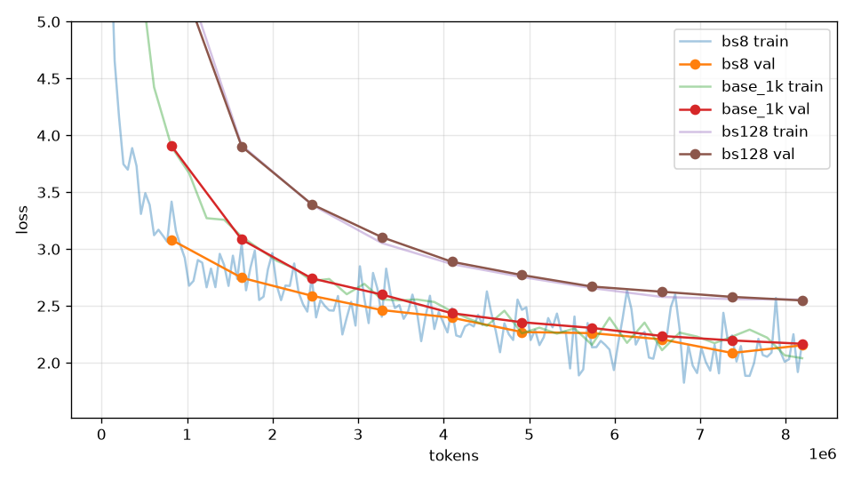

# 批次大小

## 本集目標

固定看過的 token 總數，比較 batch 8、32、128 的差別：小 batch 步數多但每步吵，大 batch 每步穩但步數少，而且速度差很多。

## 正文

### 固定 token 總數

基準 batch 32 × 1000 步 = 819 萬個 token。要公平，batch 8 就要 4000 步、batch 128 只有 250 步：

```bash
uv run tools/train.py --out_dir runs/bs8 --compile --max_steps 4000 --eval_every 400 --batch_size 8
uv run tools/train.py --out_dir runs/bs128 --compile --max_steps 250 --eval_every 25 --warmup_steps 50 --batch_size 128
```

batch 128 只有 250 步，warmup 照預設 200 步的話還沒升到最高就要開始降了，所以改成 50。這也是個提醒：改 batch 常常要連帶改排程。

### 結果

三個 run 都看了 8,192,000 個 token，學習率相同（\\( 10^{-3} \\)）：

| batch | 步數 | 看過 164 萬 token 時的驗證 loss | 410 萬 | 819 萬（結束） |
| --- | --- | --- | --- | --- |
| 8 | 4000 | 2.75 | 2.40 | **2.15** |
| 32（基準） | 1000 | 3.08 | 2.44 | 2.17 |
| 128 | 250 | 3.90 | 2.89 | 2.55 |



這張圖的橫軸是看過的 token 數（`tools/plot_loss.py --x tokens`），不是步數；用步數畫的話，batch 8 的曲線會拉到 4000、batch 128 只到 250，看起來像三個不相干的實驗。

- **batch 8 和 32 最後平手**（2.15 對 2.17，在雜訊範圍內）。batch 8 前期領先，因為同樣的 token 它多走了四倍的步數；但每一步只有 2048 個 token，訓練 loss（淡藍線）抖得很厲害。
- **batch 128 落後很多**（2.55）。只有 250 步，就算每一步的梯度很準，步數太少也走不到。大 batch 要配合**更大的學習率**才能補回步數的差距，這組實驗故意沒調，好讓你看到「只改 batch」的後果。

同樣的 token 數，存在一個 batch 的甜蜜點：太小每步太吵、太大步數太少。這個點會隨模型大小與訓練長度移動。

### 速度

| batch | 每步 | 全部時間 |
| --- | --- | --- |
| 8 | 89 ms | 5.9 分 |
| 32 | 272 ms | 4.5 分 |
| 128 | 1,438 ms | 6.0 分 |

全部時間包含編譯與定期的驗證評估（每次抽 20 批，batch 128 的每批也大四倍），所以不是單純的「每步 × 步數」。batch 8 每步只有 89 ms，但 GPU 吃不飽，步數又多，總時間反而比 32 長；batch 128 每個 token 算得並不比 32 快，加上評估成本，也比較慢。在 M4 Max 上，batch 32 剛好兼顧速度與結果。

### 真正的限制

本書的模型小，batch 128 × 256 塞得進 GPU；大模型的 batch 受記憶體限制（第 7 章），而且多卡訓練時 batch 是分攤到所有卡的（第 9 章），所以實務上 batch 大小常常是「硬體塞得下多少」決定的，再回頭調學習率。

## 重點整理

- 比較 batch 大小要固定 token 總數：`batch × steps` 相同。
- 同樣 819 萬 token：batch 8 與 32 平手（2.15、2.17），batch 128 只有 250 步、學習率沒調，落後到 2.55。
- 小 batch 每步吵、GPU 吃不飽；大 batch 步數少，要調大學習率才補得回來。比較時橫軸用 token 數。
- 改 batch 要連帶考慮 warmup 與學習率。

## 自我挑戰

這一章放進 `src/llmz/` 的是 `src/llmz/generate.py`：`greedy_next`、`sample_next`、`generate`。把三個函式本體清掉自己寫回來：

```bash
uv run pytest tests/test_generate.py
```

`sample_next` 的 top-p 那段是最容易寫錯的地方（「累積減自己」的邊界）。然後用你的 `generate` 和 `runs/base/model.pt` 生成幾個故事，確認它們通順。

最後是整個第一部的總挑戰：把 `src/llmz/` 整個目錄的函式本體全部清掉，從 `tests/` 開始，一個模組一個模組寫回來，直到 `uv run pytest` 全綠，再跑一次完整訓練。做到這裡，你已經從零寫出並訓練了一個語言模型。
